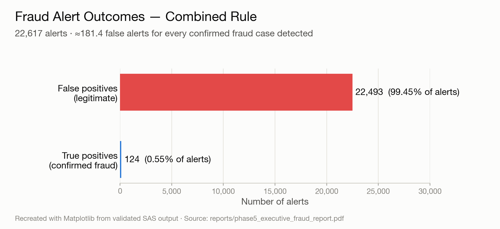
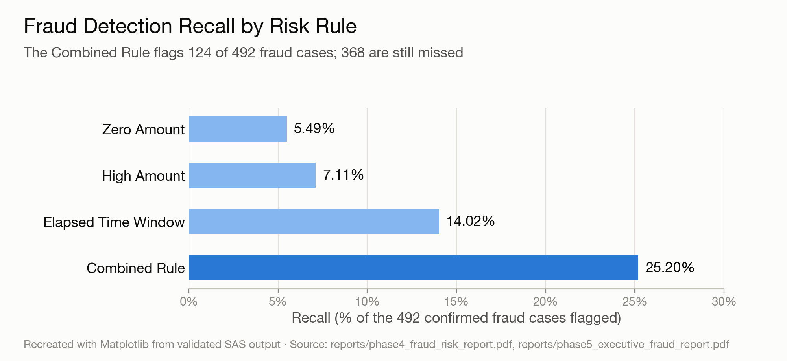
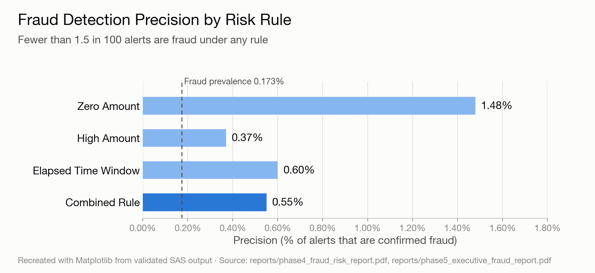
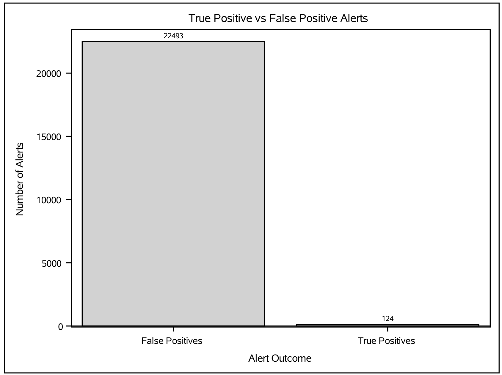
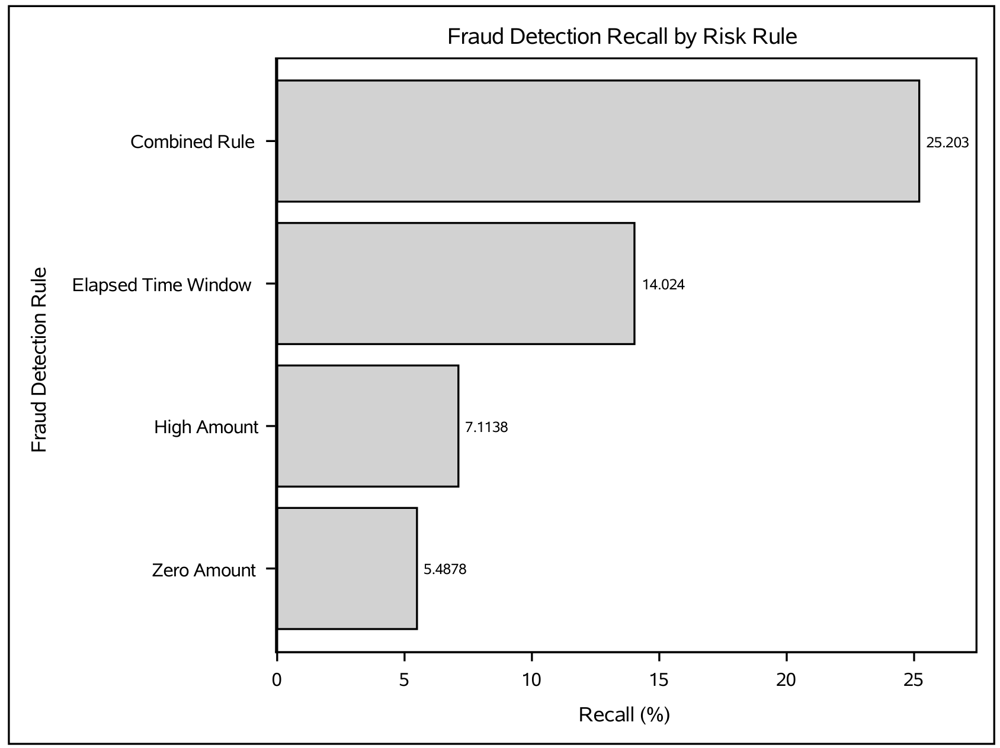

# SAS Banking Fraud Analytics

### End-to-End Credit Card Fraud Analysis, Rule-Based Detection & Executive Reporting

**Status:** ✅ Completed — November 2026  ·  **Tool:** SAS (SAS OnDemand for Academics)  ·  **Language:** SAS  ·  **License:** MIT

📄 **[Read the Executive Fraud Report (PDF)](reports/phase5_executive_fraud_report.pdf)**

---

## Executive KPI Summary

| KPI | Result |
|---|---:|
| Transactions analyzed | **284,807** |
| Confirmed fraud cases | **492** |
| Fraud prevalence | **0.173%** |
| Alerts generated | **22,617** |
| Fraud detection recall | **25.20%** |
| Precision | **0.55%** |
| False-positive rate | **7.91%** |

<sub>All figures come from the validated SAS output in [`reports/`](reports/). Results are for the Combined Rule, which raises an alert when any of the three individual risk rules fires.</sub>

---

## Visual Analytics Dashboard

### 1. Fraud Alert Outcomes



**Interpretation:** 99.45% of the 22,617 alerts were legitimate transactions. Investigators would review about **181 false alerts for every fraud case confirmed**, which makes the operational cost of this rule set its biggest weakness.

### 2. Fraud Detection Recall by Risk Rule



**Interpretation:** No single rule catches more than 14.02% of fraud. Combining the three rules raises recall to 25.20%, but **368 of the 492 fraud cases (74.8%) are still missed**.

### 3. Fraud Detection Precision by Risk Rule



**Interpretation:** Every rule flags fraud at a higher rate than the 0.173% base rate, so each one adds some signal. Precision stays below 1.5%, though, and combining the rules *lowers* precision from the best single rule (1.48%) to 0.55%. Each gain in recall is paid for with a larger investigation queue.

<details>
<summary><b>Chart provenance & original SAS output</b></summary>

<br>

The three charts above were **recreated in Matplotlib** from the validated SAS results so the dashboard has consistent styling. No values were changed. To regenerate them, run [`scripts/make_readme_charts.py`](scripts/make_readme_charts.py); it needs only `matplotlib`. The original `PROC SGPLOT` charts produced by SAS are rendered below, directly from the Phase 5 PDF. The precision chart has no standalone SAS original: in SAS, precision appears beside recall in the clustered chart in the [Phase 4 report](reports/phase4_fraud_risk_report.pdf).

| SAS `PROC SGPLOT` — Alert outcomes | SAS `PROC SGPLOT` — Recall by rule |
|---|---|
|  |  |

</details>

---

## Project Overview

**Business problem.** Card issuers need to flag fraudulent transactions quickly without overwhelming investigators with false alerts. Fraud is very rare (fewer than 2 in every 1,000 transactions), so a detection approach has to be judged on recall, precision, and investigation workload together. Accuracy alone is misleading on data this imbalanced.

**Dataset.** [Credit Card Fraud Detection](https://www.kaggle.com/datasets/mlg-ulb/creditcardfraud), a public dataset from the Machine Learning Group at Université Libre de Bruxelles (ULB), hosted on Kaggle. It contains **284,807 transactions** made by European cardholders over two days in September 2013, with 31 variables:

- `Time`: seconds elapsed since the first transaction in the dataset. This is *elapsed time*, not clock time or time of day.
- `Amount`: the transaction amount.
- `V1`–`V28`: 28 anonymized features (principal components released by the data provider for confidentiality).
- `Class`: the fraud label (1 = fraud, 0 = legitimate).

The raw `creditcard.csv` is not stored in this repository. Download it from Kaggle (see [`data/`](data/)).

<sub>**Attribution:** Dataset by the Machine Learning Group – ULB and Worldline. Cite: A. Dal Pozzolo, O. Caelen, R. A. Johnson & G. Bontempi, *"Calibrating Probability with Undersampling for Unbalanced Classification,"* IEEE Symposium Series on Computational Intelligence (SSCI), 2015. Use is subject to the license terms on the [Kaggle dataset page](https://www.kaggle.com/datasets/mlg-ulb/creditcardfraud).</sub>

**Analytical objectives**
1. Import and validate the data: data types, missing values, duplicates, invalid labels, and amount anomalies.
2. Profile how fraud differs from legitimate activity by transaction amount and elapsed time.
3. Turn the exploratory findings into transparent, rule-based risk indicators.
4. Evaluate those rules with a confusion matrix, precision, recall, and false-positive rate.
5. Summarize detection performance and the investigation-workload trade-offs for an executive audience.

---

## Five Completed Project Phases

| # | Phase | What was done | SAS script | Report |
|:-:|---|---|---|---|
| 0 | **Session Setup** | Assigns the permanent `FRAUD` library that stores intermediate datasets between SAS Studio sessions. | [`00_setup.sas`](sas/00_setup.sas) | — |
| 1 | **SAS Fundamentals** | Built a sample transaction dataset with a `DATA` step and `DATALINES`, then explored it with `PROC PRINT`, `PROC MEANS`, and `PROC FREQ`. | [`01_data_import.sas`](sas/01_data_import.sas) | — |
| 2 | **Data Import & Validation** | Imported the 284,807-row CSV with `PROC IMPORT`. Confirmed **0 missing values** across all numeric fields and **0 missing or invalid fraud labels**. Identified **1,081 exact duplicate records**, **1,825 zero-amount transactions**, and no negative amounts. Converted `Class` to a numeric `fraud_flag`. | [`02_data_import_validation.sas`](sas/02_data_import_validation.sas) | [PDF](reports/phase2_validation_report.pdf) |
| 3 | **Exploratory Fraud Analysis** | Compared amounts by fraud status: median $9.25 for fraud vs. $22.00 for legitimate transactions. Built six amount bands; the zero-amount band had the highest fraud rate (1.479%). Split elapsed time into six-hour blocks; the 24–30 elapsed-hour block peaked at 0.595%. | [`03_exploratory_fraud_analysis.sas`](sas/03_exploratory_fraud_analysis.sas) | [PDF](reports/phase3_exploratory_fraud_report.pdf) |
| 4 | **Fraud Risk Analysis** | Built three rules from the EDA findings: **Zero Amount** (`Amount = 0`), **High Amount** (`Amount ≥ 500`), and **Elapsed Time Window** (24–30 elapsed hours), plus a Combined Rule. Evaluated each with a confusion matrix, precision, recall, false-positive rate, and accuracy. | [`04_fraud_risk_analysis.sas`](sas/04_fraud_risk_analysis.sas) | [PDF](reports/phase4_fraud_risk_report.pdf) |
| 5 | **Executive Fraud Analytics Reporting** | Produced an executive KPI summary, detection-performance tables, alert-outcome and recall charts, and business-insight metrics: alert rate, missed fraud, and false alerts per detection. | [`05_executive_fraud_report.sas`](sas/05_executive_fraud_report.sas) | [PDF](reports/phase5_executive_fraud_report.pdf) |

<details>
<summary><b>Rule-level performance detail (Phase 4)</b></summary>

<br>

| Rule | Alerts | TP | FP | FN | Precision | Recall | False-positive rate |
|---|---:|---:|---:|---:|---:|---:|---:|
| Zero Amount | 1,825 | 27 | 1,798 | 465 | 1.48% | 5.49% | 0.63% |
| High Amount | 9,492 | 35 | 9,457 | 457 | 0.37% | 7.11% | 3.33% |
| Elapsed Time Window | 11,594 | 69 | 11,525 | 423 | 0.60% | 14.02% | 4.05% |
| **Combined Rule** | **22,617** | **124** | **22,493** | **368** | **0.55%** | **25.20%** | **7.91%** |

Combined Rule confusion matrix: TP = 124 · FP = 22,493 · FN = 368 · TN = 261,822 · Accuracy = 91.97%

</details>

---

## Key Business Findings

- **22,493 false-positive alerts.** 99.45% of all alerts were legitimate transactions, each of which would cost investigation time and could disrupt a genuine customer.
- **368 fraud cases missed.** The Combined Rule caught 124 of 492 confirmed fraud cases (25.20% recall). Roughly three in four fraud cases were never flagged.
- **≈181.4 false alerts per detected fraud case.** This is the clearest measure of the workload burden: an analyst team would clear about 181 legitimate alerts to find each fraudulent one.
- **Recall vs. workload trade-off.** Combining the rules raised recall from 14.02% (best single rule) to 25.20%. In return, alert volume nearly doubled (11,594 → 22,617) and precision fell to 0.55%. Rules that only look at amount and elapsed time cannot raise recall without flooding the queue.
- **Accuracy is misleading here.** The Combined Rule's 91.97% accuracy sounds strong, but simply labeling every transaction as legitimate would score 99.83%. That is why this project reports precision, recall, and false-positive rate instead.
- **A more sophisticated statistical approach should be evaluated.** The rules use only two of the 30 predictors, their thresholds were chosen by hand from exploratory analysis, and they were evaluated on the same data used to design them, with no holdout set. A multivariate model that is validated out of sample and has a tunable decision threshold is the logical next step (see [Future Work](#future-work)).

> **Scope note:** These rules are an analytical baseline, **not a production-ready fraud system**. Transaction amounts are not confirmed fraud losses, and `Time` is elapsed seconds since the first record, not time of day.

---

## Technical Skills Demonstrated

| Area | Skills |
|---|---|
| **SAS programming** | `DATA` steps (conditional logic, derived variables, wide-to-long reshaping with `OUTPUT`), SAS libraries (`LIBNAME`, `WORK` vs. permanent), `PROC IMPORT`, `PROC CONTENTS`, `PROC PRINT`, `PROC SORT` (`NODUPKEY` / `DUPOUT`) |
| **Data querying & aggregation** | `PROC SQL` (`CASE WHEN`, `CALCULATED`, `GROUP BY`, `CREATE TABLE`), `PROC FREQ` (one-way and cross-tab), `PROC MEANS` (`CLASS`, `NMISS`) |
| **Data validation** | Missing-value audit, duplicate detection, label-integrity checks, amount anomaly checks (zero, negative, missing), type conversion |
| **Fraud analytics** | Class-imbalance awareness, rule-based risk indicators, confusion matrices, precision, recall, false-positive rate, false-positive burden analysis |
| **Visualization** | `PROC SGPLOT` (`VBAR`, `HBAR`, `VBARPARM`, `SERIES`, grouped/clustered bars) |
| **Reporting** | `ODS PDF` consolidated reports, executive KPI summaries, business interpretation of model trade-offs |

---

## Repository Structure

```
sas-banking-fraud-analytics/
├── README.md
├── LICENSE
├── assets/                                  # README visualizations
│   ├── 01_fraud_alert_outcomes.png          # recreated (Matplotlib) from SAS output
│   ├── 02_recall_by_rule.png                # recreated (Matplotlib) from SAS output
│   ├── 03_precision_by_rule.png             # recreated (Matplotlib) from SAS output
│   └── sas-original/                        # original PROC SGPLOT charts from the Phase 5 PDF
│       ├── sas_alert_outcomes.png
│       └── sas_recall_by_rule.png
├── data/                                    # raw CSV not committed
├── docs/
├── reports/
│   ├── phase2_validation_report.pdf
│   ├── phase3_exploratory_fraud_report.pdf
│   ├── phase4_fraud_risk_report.pdf
│   └── phase5_executive_fraud_report.pdf
├── scripts/
│   └── make_readme_charts.py                # regenerates the three README charts
└── sas/
    ├── 00_setup.sas                         # assigns the permanent FRAUD library
    ├── 01_data_import.sas
    ├── 02_data_import_validation.sas
    ├── 03_exploratory_fraud_analysis.sas
    ├── 04_fraud_risk_analysis.sas
    └── 05_executive_fraud_report.sas
```

### Running the code

The scripts were developed in SAS OnDemand for Academics (SAS Studio). Key datasets are saved to a permanent `FRAUD` library, so later phases can run in a new session without repeating earlier ones.

| When | Run |
|---|---|
| First time (full rebuild) | `00_setup` → `02` → `03` → `04` → `05` |
| New session: regenerate the executive report | `00_setup` → `05` |
| New session: re-run the risk rules | `00_setup` → `04` (then `05`) |

| Permanent dataset | Written by | Read by |
|---|---|---|
| `FRAUD.CREDITCARD_CLEAN` | Phase 2 | Phase 4 |
| `FRAUD.CREDITCARD_RISK` | Phase 4 | Phase 5 |
| `FRAUD.ALL_RULE_COMPARISON` | Phase 4 | Phase 5 |

Phase 1 is a standalone warm-up. Phase 3 reads `WORK.CREDITCARD_CLEAN`, which exists only in the session where Phase 2 ran; [`00_setup.sas`](sas/00_setup.sas) includes an optional step to restore it. To use your own SAS account, update the paths in the `LIBNAME`, `PROC IMPORT`, and `ODS PDF` statements.

---

## Executive Report

> 📄 **[Executive Fraud Analytics Report — `reports/phase5_executive_fraud_report.pdf`](reports/phase5_executive_fraud_report.pdf)**
>
> A five-page SAS-generated summary: the KPI overview, detection performance (precision, recall, false-positive rate), the alert-outcome and rule-recall charts, and business insights (7.94% alert rate, 368 missed fraud cases, 181.4 false alerts per detection).

---

## Future Work

**Project 2: SAS Statistical Modeling & Fraud Prediction** *(planned, not part of this completed project)*

The next project will test whether a statistical model can beat the rule-based baseline above. Planned scope:

- **Hypothesis testing** to check whether fraud and legitimate transactions differ significantly on amount and the anonymized features
- **Logistic regression** (e.g., `PROC LOGISTIC`) using the full set of predictors
- **Train/test evaluation** so performance is measured on held-out data
- **ROC-AUC** to compare discrimination with the rule-based baseline
- **Threshold optimization** to balance recall against investigation workload

---

<sub>© 2026 Vijayarajan Devannah · Released under the [MIT License](LICENSE)</sub>
